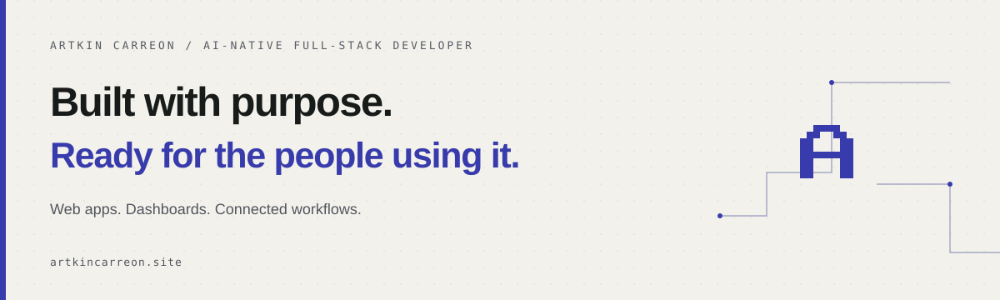

### Hi, I’m Artkin.

I build **web apps, dashboards, and connected workflows**. Based in the Philippines, with a background in Computer Engineering.

I use AI to move the work forward, then review the code, test the important flows, and check what actually works before launch.

[Portfolio ↗](https://artkincarreon.site) &nbsp; / &nbsp; [LinkedIn ↗](https://www.linkedin.com/in/artkin-carreon-8809b8421/) &nbsp; / &nbsp; [Let’s talk ↗](https://artkincarreon.site/contact)

---

### Selected work

**[Portfolio & booking system ↗](https://artkincarreon.site)**  
A live Next.js application with Google Calendar and Meet booking, secure rescheduling and cancellation, email notifications, and admin tools for appointments and contacts.  
Next.js · React · TypeScript · Supabase · PostgreSQL · Vercel

**[AquaFeedPro ↗](https://artkincarreon.site/work/aquafeedpro-automatic-fish-feeder-and-monitoring-system)**  
I independently built the app and backend for automatic scheduled feeding, connecting the controls people use with feeding schedules and history.  
App & backend development · Scheduled workflows · Device integration

**[Clinic AI receptionist ↗](https://artkincarreon.site/work/clinic-ai-receptionist-and-appointment-automation)**  
A personal automation project connecting Facebook Page inquiries with appointment booking, changes, and email reminders.  
n8n · AI-assisted conversations · API integrations

### How I build

**Plan → Build → Review → Verify**

I turn a detailed plan into small Linear tasks with clear goals. Independent tasks run in parallel on separate branches, with an orchestrator coordinating development and QA agents. I inspect the changes, resolve issues, and verify the user flows before merging and deploying.

### Tools I work with

**Frontend** &nbsp; Next.js · React · TypeScript · Tailwind CSS  
**Backend & data** &nbsp; Supabase · PostgreSQL · APIs · Webhooks  
**Automation** &nbsp; n8n · GoHighLevel · Google Calendar  
**Development** &nbsp; Codex · Claude Code · Git · Linear · Playwright · Vercel

---

**Have a product in mind? [Let’s build it ↗](https://artkincarreon.site/contact)**
